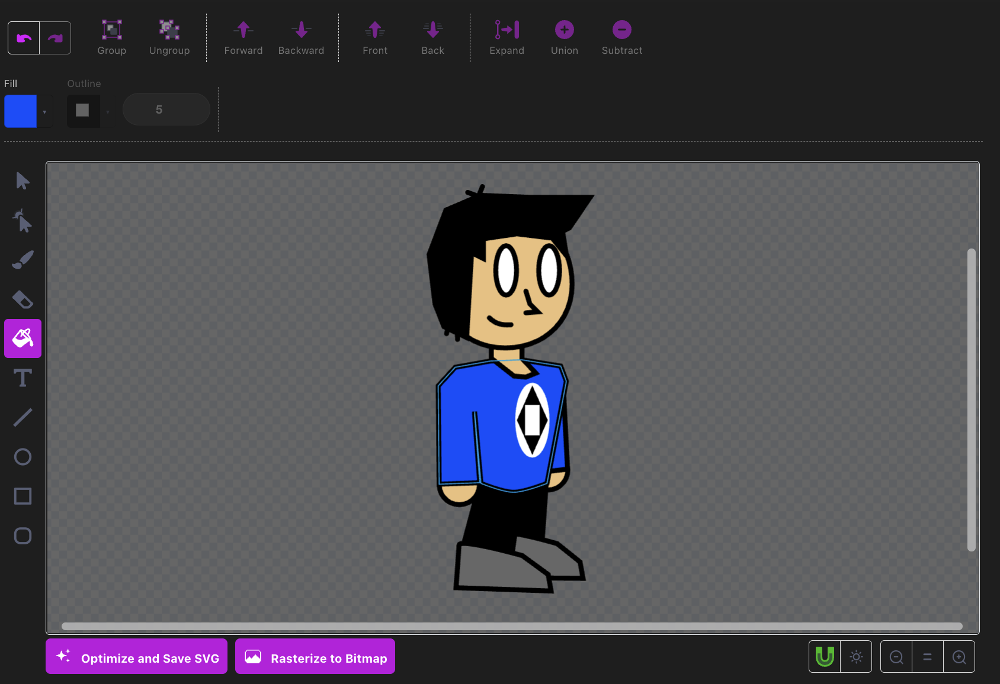

# Vetch by MarbleStack

**Vetch** is an extension for Visual Studio Code that allows you to easily open, view, and edit `.svg` files without interrupting your workflow.

## Features

* **Fully Visual SVG Editing:** No need to manually edit tags; just draw, drag, and drop like a normal human being.
* **Familiar Interface:** Utilizes the intuitive and simple Scratch 3.0 vector paint editor as a base with more powerful features listed below.
* **Geometry Tools:** Includes the essential tools of Select, Reshape, Brush, Erase, Fill, Text, Line, Ellipse, Rectangle, and Squircle.
* **Transformation Tools:** Includes the essential tools to move, scale, rotate, flip, center, and layer.
* **Editor Tools:** Includes the essential tools to modify colors, gradients, copy/paste, undo/redo, group/ungroup.

* **Massive Canvas:** Easily adjust, scale, skew, rotate, and move elements around without boundaries.
* **Canvas Panning:** Use the middle mouse button to pan around the canvas.
* **Skewing:** Hold CTRL while dragging one of the four midpoints of a selection box to skew shapes.
* **Opacity and HEX Sliders:** Adjust the opacity and HEX values of selected shapes using the color picker.
* **Dark/Light Canvas Toggle:** Toggle between a light and dark canvas to make editing easier depending on your color schemes.
* **Snapping:** Switch between freehand mode and snapping mode to easily align shapes.
* **Copy/Pasting Between Editors:** Copy and paste between open Vetch instances to easily transfer graphics.
* **Transfer between Vetch and Scratch:** Transformation offsets from the origin and preserved between Vetch and Scratch.
* **Quick Transforms:** Press G, then X or Y, then type a distance to move the selection, or press R and type an angle to rotate it. Works on shapes and on selected points.
* **Keyboard Shortcuts:** Switch tools with V, A, B, E, F, T, L, C, and S, and press P to toggle the selected points between curved and pointed. Hover a tool to see its key.
* **Shared Settings:** Your tool, colors, sizes, and view carry over between open Vetch editors.

* **Boolean Operations:** Use the union and difference tools to combine, subtract, and intersect shapes.
* **Expand Stroke:** Use the expand stroke tool to solidify outlines and edit them as geometric shapes.
* **Squircle Tool:** Draw rectangles with rounded corners, then change the corner radius of any shape's corners (or just the corners at the selected points) from the toolbar.
* **Midpoint Tool:** Add a point exactly halfway between two selected points, or Shift-click an outline to add a centered point.
* **Line Caps:** Give lines butt, round, or square ends. Expand Stroke keeps the cap style.
* **Optimize and Save SVG:** Shrink the file by removing unneeded data and save it in one click.
* **Rasterize to Bitmap:** Turn shapes into a flat image inside the SVG.
* **Installed Fonts:** The text tool uses fonts installed on your computer, each with a standard fallback so the text still shows up on computers without that font.

## Usage

1. Open an SVG file.
2. Enjoy the feeling of superiority of the fact you have a graphic editor inside your code editor.

*Tip 1: You may need to set the default editor for SVG files to Vetch. To do this, right-click the file in the Explorer, select "Open With...", and choose "Vetch".*  
*Tip 2: If you ever need to view the raw SVG code, right-click the file in the Explorer, select "Open With...", and choose the default "Text Editor".*  

## Support the Project

If this extension saves you time or makes your life easier, consider giving me money. If it doesn't, consider giving me money.

## License & Attribution

This extension is open-source and licensed under the **GNU Affero General Public License v3.0 (AGPL-3.0)**. 

**Attribution:** Vetch utilizes a modified version of `scratch-paint`, an open-source project originally developed by the MIT Scratch Team. The original Scratch source code is also licensed under the AGPL-3.0. "Scratch" is a trademark of the Massachusetts Institute of Technology. This project is not affiliated with, sponsored by, or endorsed by MIT or the Scratch Team.